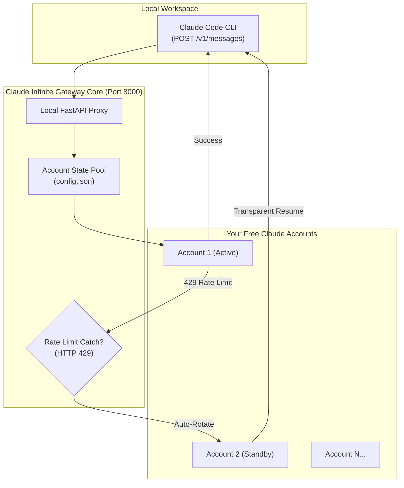

# ⚡ Claude Infinite — Multi-Account Failover Architecture for Claude Code

> **Run the official Claude Code CLI without a paid monthly subscription. Pool your free Claude accounts for continuous, uninterrupted coding with automated rate-limit failover.**

[](LICENSE)
[](#features)
[](#architecture)

---

## 🚀 The 1-Click Windows Starter Kit

**Tired of paying $20/month for Claude Pro just to run the Claude Code CLI?**  
**Tired of getting locked out by strict 5-hour rate limits right in the middle of a project?**

The **Turnkey Starter Kit** gives you a pre-configured Windows package that gets you up and running in under 3 minutes:
- ⚡ **No Terminal Setup Required:** Pre-bundled 1-click launchers (`RUN_CLAUDE_CODE_FREE.bat`).
- 💻 **Global `cc` Command:** Launch Claude Code from any project directory by simply typing `cc`.
- 📊 **Real-Time Terminal HUD:** Live status banner showing exactly how much quota and cooldown time remains on each account.
- 🔔 **Desktop Alerts:** Automatic Windows notifications if an account ever needs a cookie refresh.
- 🛠️ **Visual Account Manager:** Add, test, and manage as many free Claude accounts as you want with a simple interactive menu.

👉 **[Get the 1-Click Starter Kit on Gumroad](https://daniyalz7.gumroad.com/l/claude-infinite)**

---

## 🏛️ System Architecture

Claude Infinite implements a local reverse-proxy gateway that sits between the Claude Code CLI and Anthropic's web backend:



---

## 🔬 How It Works

1. **Native Messages Protocol:** Claude Code connects to `http://localhost:8000` assuming it is communicating with the official Anthropic API.
2. **Web-Tier Session Routing:** The proxy translates standard Anthropic Messages requests into `claude.ai` web-tier requests using browser `sessionKey` cookies.
3. **Automated Cooldown Tracking:** When an active account approaches or hits Anthropic's free quota limit (HTTP 429), the proxy catches it in real time, places that account on a cooldown timer, and routes the current prompt to the next available account.
4. **100% Local & Secure:** All session keys are stored locally on your machine in `config.json`. No external telemetry or cloud servers.

---

## 🛠️ Manual Installation (For Advanced Developers)

### 1. Dependencies
```bash
pip install fastapi uvicorn curl_cffi requests
npm install -g @anthropic-ai/claude-code
```

### 2. Configure Accounts
Create a `config.json` based on `config.example.json` with your browser's `sessionKey` and Organization UUID.

### 3. Launch Core Proxy
```bash
python proxy_core.py
```

### 4. Inject Environment Variables & Run
```bash
export ANTHROPIC_BASE_URL=http://localhost:8000
export ANTHROPIC_API_KEY=dummy-key-free-tier
claude --prompt-suggestions false
```

---

## 📄 License
MIT License. Created for local developer productivity and workflow continuity.
