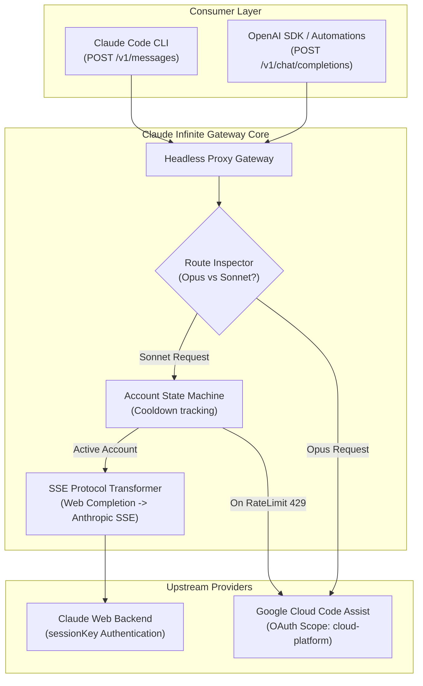

# ⚡ Claude Infinite — Dual-Engine Hybrid Proxy Architecture

> High-throughput reverse-proxy gateway bridging Anthropic Claude Code CLI with upstream web-tier session pools and Google Cloud Code Assist endpoints.

[](LICENSE)
[](#protocol-specification)
[](#architecture)

---

## 🚀 Looking for the Turnkey 1-Click Windows Starter Kit?

Don't want to spend hours manually configuring reverse-proxy daemons, SSL handshakes, and credential rotation scripts?

The **Turnkey Starter Kit** includes everything pre-configured and automated out-of-the-box:
- ⚡ **1-Click Launchers:** Pre-packaged executable scripts (`RUN_FREE`, `RUN_OPUS`).
- 💻 **Global `cc` CLI Command:** Type `cc` anywhere on your machine in any terminal or project directory.
- 📊 **Real-Time Terminal HUD:** Live compact status card showing account health, quota, and cooldown countdowns.
- 🔔 **Instant Alerts:** Windows 11 desktop notifications and email alerts when keys need refresh.
- 🛠️ **Interactive Account Manager:** Visual console for adding unlimited accounts in a loop without touching JSON.

👉 **[Download the 1-Click Starter Kit on Gumroad](https://daniyalz7.gumroad.com/l/claude-infinite)**

---

## 🏛️ System Architecture

Claude Infinite implements a dual-engine protocol translation gateway that sits between client applications (Claude Code CLI, Cursor, n8n) and upstream model backends:



---

## 🔬 Protocol Translation Specification

1. **Anthropic SSE Ingestion:**
   Incoming requests to `/v1/messages` are parsed into a normalized state payload.
2. **Upstream Web Dispatch:**
   The gateway handles Cloudflare TLS fingerprint impersonation via `curl_cffi` (mimicking Chrome 131 HTTP/2 client handshakes) using persistent `sessionKey` cookies.
3. **Stream Transformation:**
   Anthropic's raw completion chunks are dynamically converted into standard Anthropic Messages SSE events:
   - `message_start`
   - `content_block_start`
   - `content_block_delta`
   - `message_delta`
   - `message_stop`
4. **Google Cloud Code Assist Bridging:**
   For Opus or secondary Sonnet failover, requests are transformed to Google's internal Cloud AI Companion JSON-RPC schema over HTTPS.

---

## 🛠️ Manual Installation (For Advanced Engineers)

> [!WARNING]
> Manual setup requires configuring background Node.js reverse-proxy daemons, managing process lifecycles, and configuring system environment variables manually.

### 1. Dependencies
```bash
pip install fastapi uvicorn curl_cffi requests httpx
npm install -g @anthropic-ai/claude-code
```

### 2. Upstream Proxy Configuration
To enable the Google Antigravity bridge manually, you must deploy and manage an upstream OAuth proxy daemon on port `8080` with the `cloud-platform` scope:
```bash
npx antigravity-claude-proxy start --strategy=hybrid
```

### 3. Run Core Gateway
```bash
python proxy_core.py
```

### 4. Client Environment Injection
In every terminal session where you run Claude Code, you must manually export the bypass headers before launching the CLI:
```bash
export ANTHROPIC_BASE_URL=http://localhost:8000
export ANTHROPIC_API_KEY=dummy-key-free-tier
claude --prompt-suggestions false
```

---

## 📄 License
MIT License. Created for local developer experimentation and reverse-proxy research.
