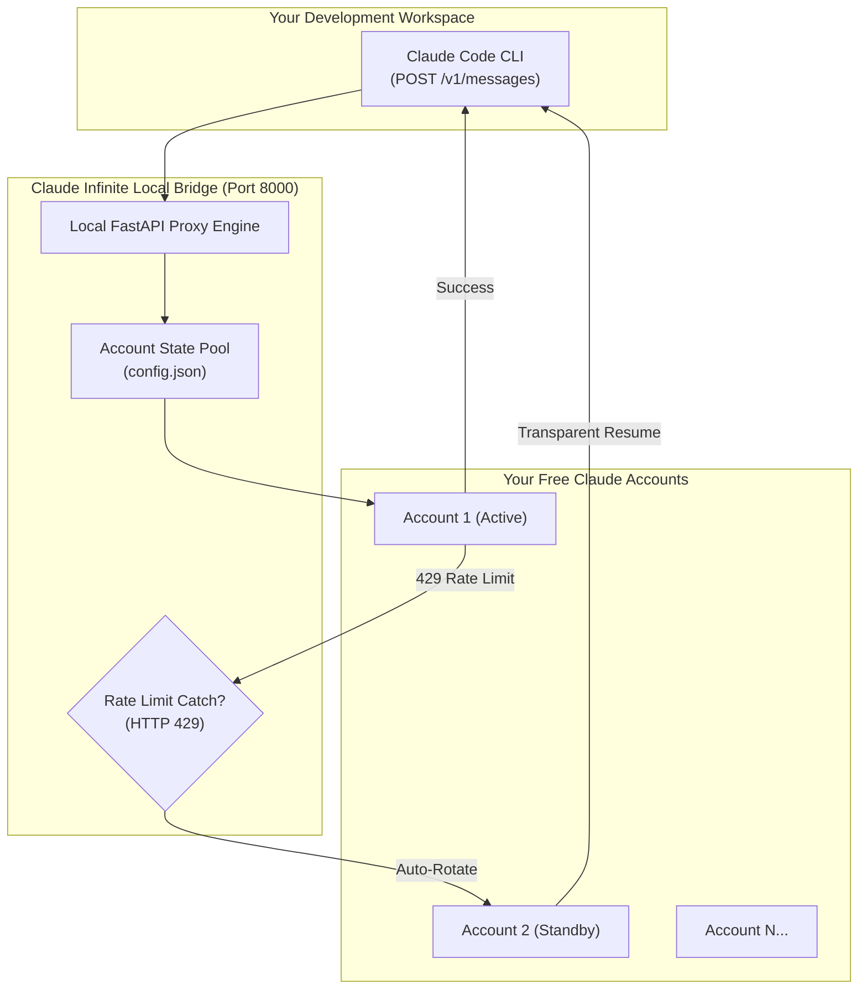

<div align="center">


# ⚡ Claude Infinite
### Multi-Account Failover Suite for the Official Claude Code CLI

[-8A2BE2?style=for-the-badge&logo=gumroad)](https://daniyalz7.gumroad.com/l/claude-infinite)
[](LICENSE)
[](#)
[](#)

<p align="center">
  <strong>Run the official Anthropic Claude Code CLI without a paid monthly subscription.</strong><br>
  Pool your free Claude accounts for continuous, uninterrupted coding with zero-drop rate-limit failover.
</p>

[**🚀 Get the 1-Click Starter Kit**](https://daniyalz7.gumroad.com/l/claude-infinite) • [**📖 Architecture**](#-architecture) • [**⚡ Comparison**](#-the-cost-comparison) • [**🛠️ Manual Setup**](#-manual-developer-setup)

</div>

---

## 🛑 The Problem You Face Every Day

1. **The $20/Month Paywall:** Claude Code CLI normally demands an active paid **Claude Pro ($20/mo)** subscription or pre-funded Anthropic Console API credits.
2. **The 5-Hour Lockout:** Even paid users constantly slam into strict **5-hour rate limits (HTTP 429)** right in the middle of writing critical code.
3. **Context Drop:** When your account gets locked out, your terminal session freezes and you lose your entire train of thought.

## ✅ How Claude Infinite Solves It

- **Multi-Account Failover Pool:** Connect as many free `claude.ai` accounts as you have.
- **Zero-Drop Session Continuity:** When Account 1 reaches its limit, the local bridge automatically rotates to Account 2 without restarting your terminal or dropping conversation state.
- **Global `cc` Command:** Launch Claude Code from any project directory on your machine with one simple command.
- **Real-Time Terminal HUD:** Clean live status banner at the top of your terminal displaying remaining quota, active accounts, and reset countdowns.

---

## ⚡ The Cost Comparison

| Feature | Official Claude Pro | Anthropic API Credits | Claude Infinite Starter Kit |
| :--- | :---: | :---: | :---: |
| **Monthly Cost** | **$20 / month** ($240/yr) | **$50–$150 / month** | **$0 / month** ($14 one-time) |
| **Rate Limit Behavior** | Hard lock for 5 hours | Expensive token billing | **Auto-rotates to standby account** |
| **Multi-Account Pooling** | ❌ No | ❌ No | **✔ Yes (unlimited accounts)** |
| **CLI Turn Continuity** | ❌ Session halted | ❌ Billing spike | **✔ Zero-drop failover** |
| **Global `cc` Shortcut** | ❌ No | ❌ No | **✔ Yes (launches anywhere)** |
| **Live Telemetry HUD** | ❌ No | ❌ No | **✔ Yes (real-time quota status)** |

<div align="center">

[-7C3AED?style=for-the-badge)](https://daniyalz7.gumroad.com/l/claude-infinite)

</div>

---

## 🏛️ Architecture



---

## 📦 What's Inside the 1-Click Starter Kit ($14)

If you don't want to write proxy code or manually configure terminal headers, the **Turnkey Starter Kit** gives you a pre-configured Windows bundle:
- 🚀 **`RUN_CLAUDE_CODE_FREE.bat`**: 1-click launcher that verifies the bridge and boots Claude Code.
- 💻 **`cc.cmd`**: Universal global command. Put it in your PATH and type `cc` from any directory.
- 📊 **`STATUS.bat` & `status.py`**: Real-time terminal HUD showing live cooldowns and quota availability.
- 🛠️ **`MANAGE_ACCOUNTS.bat`**: Visual interactive console to add, test, and manage accounts with zero JSON editing.
- 🔔 **`notifier.py`**: Automatic Windows desktop notifications and email alerts when keys need refresh.
- 📖 **`README_SETUP_GUIDE.md`**: Complete step-by-step documentation with screenshots.

<div align="center">

[](https://daniyalz7.gumroad.com/l/claude-infinite)

</div>

---

## 🛠️ Manual Developer Setup (For Advanced Engineers)

If you prefer to configure everything manually from scratch:

### 1. Requirements
```bash
pip install fastapi uvicorn curl_cffi requests
npm install -g @anthropic-ai/claude-code
```

### 2. Configure State
Create `config.json` with your browser `sessionKey` and Organization UUID:
```json
{
  "api_port": 8000,
  "accounts": [
    {
      "name": "Account_1",
      "session_key": "sk-ant-sid02-...",
      "org_uuid": "your-org-uuid",
      "org_name": "My Account",
      "enabled": true,
      "rate_limited_until": 0
    }
  ]
}
```

### 3. Run Proxy & Inject Environment
```bash
python proxy_core.py
export ANTHROPIC_BASE_URL=http://localhost:8000
export ANTHROPIC_API_KEY=dummy-key-free-tier
claude --prompt-suggestions false
```

---

## ❓ Frequently Asked Questions

#### Does this require leaving a browser open?
**No.** The Python proxy communicates directly with Anthropic servers via encrypted HTTP requests. You can close all browser windows completely.

#### How many accounts can I add?
As many as you have! Adding 3 accounts gives you ~3x the standard quota window. When one account hits limit, the proxy automatically moves to the next.

#### Is my data safe?
**100% local.** All cookies and keys stay encrypted in your local `config.json` on your machine. Nothing is ever sent to any third-party cloud server.

---

<div align="center">

### Ready for Continuous, Friction-Free Coding?

[-Instant%20Download-8B5CF6?style=for-the-badge&logo=gumroad)](https://daniyalz7.gumroad.com/l/claude-infinite)

<p align="center">
  MIT License • Created for local developer productivity
</p>

</div>
